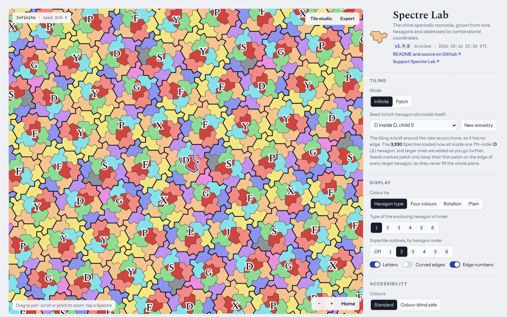
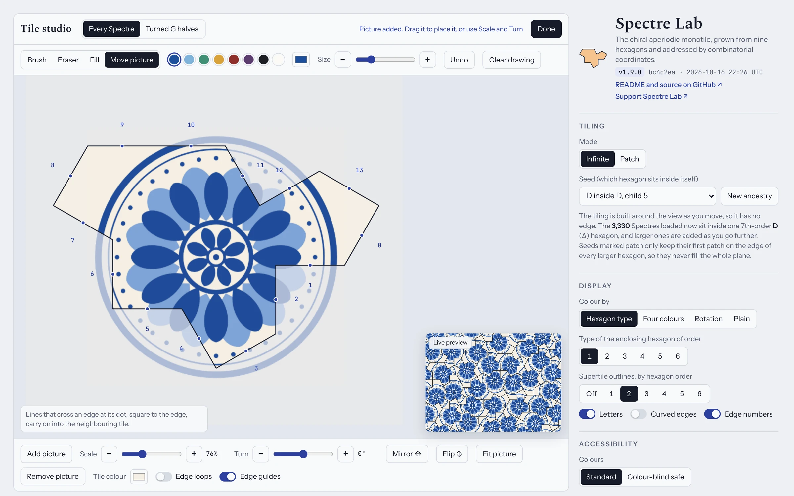
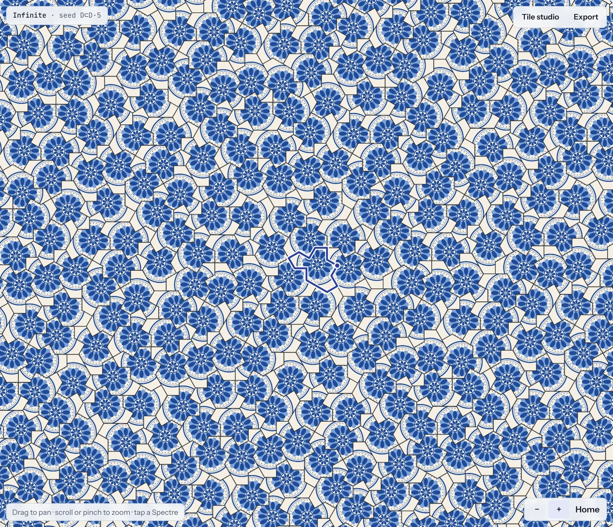

# Spectre Lab

An interactive explorer for the Spectre, the chiral aperiodic monotile found by Smith, Myers, Kaplan and Goodman-Strauss in 2023. It is a single self-contained HTML page: no install, no server, no dependencies.

**[Open Spectre Lab](https://sockmonke-rgb.github.io/Spectre-Lab/)**

<a href="https://sockmonke-rgb.github.io/Spectre-Lab/">
  <picture>
    <source media="(prefers-color-scheme: dark)" srcset="docs/screenshot-dark.webp">
    
  </picture>
</a>

## What it does

- **Grows a real Spectre tiling** by substituting nine hexagon types, from 1 to 5 steps (9 to about 35,000 tiles). Seeds that contain themselves keep each patch exactly inside the next, so adding a step grows the tiling around what you are looking at. A random ancestry option makes up the hierarchy one level at a time, weighted by how common each hexagon type is.
- **Uses exact geometry.** Every vertex is an integer combination of 1, d, d², d³ with d = e^(iπ/6).
- **Colours and structure:** hexagon type at any order, a proper four-colouring, rotation, or plain; supertile outlines and letters; curved edges that show the odd-to-even rule that makes the tile strongly chiral.
- **Combinatorial coordinates:** tap a tile to see which child it is of which hexagon, all the way to the root, and walk across any of its 14 edges.
- **Tile studio:** paint one Spectre or place a picture on it, then tessellate it. The design can turn with each tile, stay upright, or become one picture spread under the whole tiling. Tint, grout and a separate design for the turned G halves are optional.
- **Export** a PNG (2,000 to 8,000 px on the long edge, optionally transparent) or a one-page PDF (A4, A3 or Letter, about 300 dpi).

| Design one tile in the tile studio | and every Spectre in the tiling takes it on |
| --- | --- |
|  |  |

## Using it

Live at **https://sockmonke-rgb.github.io/Spectre-Lab/**, or open `dist/spectre-lab.html` in a browser.

- Fonts come from Google Fonts; without a connection the page falls back to system fonts.
- Saving files uses the save prompt when the page runs as a Claude artifact. Opened anywhere else, an export appears in a window, where you can right-click or long-press it to save.
- Your tile design is kept in the browser's local storage, so it stays on that browser only.

## Versions

The version lives in `package.json`. Each build stamps three things into the page: the version, a 7-character hash of the sources, and the build time in UTC. The stamp appears:

- under the title in the app,
- in the browser console when the page loads,
- in exported PDFs (caption and document properties) and PNGs (a `Software` text field).

If the stamp in the app is older than the latest build, you are looking at a cached copy. Reload the page.

To release a new version: bump `version` in `package.json`, add an entry to `CHANGELOG.md`, run `npm test` and `npm run build`, commit, and tag it `vX.Y.Z`.

## Developing

Requires Node 18 or newer.

```sh
npm test         # engine and file-format tests (node:test)
npm run build    # writes dist/spectre-lab.html
```

Set `SOURCE_DATE_EPOCH` to fix the build timestamp. The source hash depends only on the sources and the version, so the same sources always produce the same build hash.

| Path | What it holds |
| --- | --- |
| `src/core.js` | Substitution engine: exact Z[d] transforms, the nine hexagon rules, adjacency, nesting seeds, four-colouring |
| `src/fileformats.js` | One-page PDF writer and PNG text chunks |
| `src/app.js` | Rendering, interaction, tile studio, export |
| `src/page.html` | Markup and styles, with placeholders for the scripts and the version stamp |
| `scripts/build.js` | Assembles `src/` into `dist/spectre-lab.html` |
| `scripts/site.js` | Wraps the built page as the standalone site in `_site/` |
| `test/` | Tests for the engine, the file formats and the site page |
| `dist/spectre-lab.html` | The built page, committed so the repo works without building |

## Deploying

Every push to `main` publishes the site through GitHub Actions (`.github/workflows/pages.yml`), except pushes that only touch `docs/` or Markdown files: it runs the tests, builds the page from `src/`, and serves it as `index.html`. `dist/spectre-lab.html` is a fragment, because claude.ai supplies the document around an artifact; `npm run site` wraps it for an ordinary web host with a doctype, a mobile viewport, a favicon and link-preview tags (the preview image is `docs/social.png`). The build stamp uses the commit time, so a given commit always produces the same page. If the committed `dist/` is older than `src/`, the run still deploys a fresh build and leaves a warning.

One-time setup: Settings > Pages > Source: **GitHub Actions**.

## Sources and credits

- D. Smith, J. S. Myers, C. S. Kaplan and C. Goodman-Strauss, [A chiral aperiodic monotile](https://arxiv.org/abs/2305.17743) (2023). The nine hexagon substitution rules come from this paper, and the supertile placement follows the construction in Craig S. Kaplan's reference implementation that accompanies it.
- Simon Tatham, [Combinatorial coordinates for the aperiodic Spectre tiling](https://www.chiark.greenend.org.uk/~sgtatham/quasiblog/aperiodic-spectre/). The hexagon letters (G D J L X P S F Y), child numbers, Spectre edge numbers, the exact Z[d] coordinates and the four-colouring follow this article.

## License

MIT. See [LICENSE](LICENSE).
